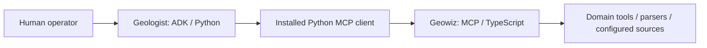

# SHALE YEAH architecture

SHALE YEAH augments an oil-and-gas evaluation team with 14 specialist employees.
Each agent has a job and human owner; it prepares evidence and work products for
review. A tool server supplies bounded domain tools and data hooks. Either unit
can be used independently through its supported interface.

[ADR 0001](adr/0001-durable-employee-contracts.md) defines target boundaries and
migration rules. [topology.md](topology.md) describes the target topology;
[mvp-release-plan.md](mvp-release-plan.md) gives issue order and acceptance gates.
This page describes current implementation and gaps.

## Current building block

The Geologist is an ADK (Agent Development Kit) Python package. Its configured
MCP (Model Context Protocol) wrapper calls independently runnable Geowiz over
HTTP. Geowiz processes domain inputs; the agent selects tools and prepares work.

Geologist does not import Geowiz TypeScript source. Its thin role adapter calls
the versioned [Python MCP client](../sdk/python/README.md) at a validated endpoint.
#679 supplies installed-wheel isolation, dedicated credential references,
safe typed failures and bounded setup retries without post-dispatch replay.
#668 supplies tested
independent HTTP protocol/transport lifecycles. #677 supplies declared-schema,
structured-result and genuine-failure boundary checks in the SDK/Geologist;
the shared client preserves those result checks. #678 requires
configured identity/scopes/audit at HTTP entry, including direct external clients
on each request. #722 replaces the session transport with explicitly selected
stateless exchanges. See [HTTP access](../sdk/docs/http-access.md).
Transport metadata is not authority; actual role result schemas/domain qualification
remain owned by #671/#674 and their role peers.

[ADR 0004](../contracts/docs/0004-composition-conformance.md), delivered by #572,
specifies our/third-party employee and MCP combinations, standalone use and optional
coordination. #722 selects MCP 2026-07-28 for stdio and Streamable HTTP;
previous 2025-11-25 receipts remain historical evidence. Geologist, Reporter and QA
use ADK 2.4.0, with Python MCP 2.3.0 through the installed client. The nine
remaining ADK callers retain their existing ADK 2.5.0 locks and now use that
same installed MCP client. Their employee workflow qualification remains pending. TypeScript
uses server/client 2.3.1 and Node adapter 2.1.1 with explicit modern options.
A2A remains unconfigured and unqualified. Executed external employee record cases
prove structure/binding; future adapter scenarios define discovery, error, scope,
review, cancellation and credential acceptance checks.

The agent requests ADK confirmation for `save_geowiz_finding`. That flag does
not prove authenticated revision-bound professional review or restart recovery.
Its development manifest declares in-memory sessions. The
[retained embedding runtime](../agents/geologist/docs/WORKING_CONTEXT.md) now
provides native ADK/SQLite context, current-source checks and scoped recovery;
authenticated review/revision/private save resume uses the [Geowiz review adapter](../servers/geowiz/docs/HUMAN_REVIEW.md). The reference reasoning/synthesis path uses explicit
Gemini/Anthropic profiles with independent judge configuration;
[provider setup](model-providers.md) states its fixture qualification and limits.

Geowiz now separates source authority from model/tool authority through the
[connector runtime](../connectors/README.md). Server-owned grants bind the
customer, asset, task/revision, employee and operator. Actual LAS/CSV bytes,
source revision, age and units are checked before publishing canonical provenance;
Geowiz's LAS handlers parse private snapshots. Audit persistence is required.
The [initial LAS review packet](../servers/geowiz/docs/LAS_REVIEW.md) carries
source hashes, observed curve coverage, explicit density assumptions and unknown
geological conclusions. The model may add an unreviewed cited annotation;
it cannot replace deterministic measurements or approve interpretation.
Other file formats and domain correctness remain unqualified; non-LAS MCP
handlers explicitly decline until their adapters are reviewed. Existing
source-independent helper APIs are not an access boundary.

The Reporter now uses the same installed helpers through its own role factory.
Its source interface reads reviewed business artifacts, preserves literal values
and requires exact qualified human review before private release. It does not
certify disclosures or send reports externally. See the [Reporter package](../agents/reporter-agent/README.md).

The [QA employee](../agents/quality-assurance/README.md) reads immutable observed
results, keeps its own source-linked context, and proposes exact private dispositions.
Its backend rechecks current input/profile/policy authority and an installed
packet-bound qualification before authenticated owner approval can execute.
An accepted exception retains the failed result and cannot repair data or certify
a release. Native confirmation alone grants no authority.

## Packages and dependency boundaries

| Area | Current responsibility | Target boundary |
| --- | --- | --- |
| `contracts/` | Canonical JSON Schema 0.1.0, generated TypeScript types and Python/TypeScript validators for employee records | Extractable business contracts independent of agent, tool, model and storage adapters |
| `connectors/` | Installed read-only adapters, scoped current grants, verified source artifacts and private parser snapshots; Geowiz first consumer | Extractable source runtime independent of agent, model, warehouse and orchestration |
| `agents/<role>/` | Specialist tools/reasoning, ADK assets or remaining TypeScript implementation | Independent employee with versioned job/task/product/context/review/eval contracts |
| `servers/<name>/` | 14 TypeScript MCP servers with domain handlers and data hooks | Independent permitted-client interface, its own adapters and access enforcement |
| `sdk/` | TypeScript contracts, models/parsers, server helpers, model client and legacy runtime | Small contract artifacts/bindings separated from installed utilities/adapters |
| `sdk/python/` | Independently buildable `shaleyeah-mcp-client`; Geologist first consumer | Installed protocol adapter with no ADK/domain/root source imports |
| `sdk/employee/` | Installed scoped context, providers/events, native runtime and protected review client; role factories own persona/tool selection | Independently installable helpers with optional ADK adapter and no employee imports |
| `orchestrator/` | Version-constant stub with a workspace SDK dependency | Optional Chief of Staff unit; #675 charter selects bounded ADK/Python pilot implemented in #676 |

Twelve agents have ADK manifests: Geologist, Reporter, Quality Assurance, Risk Analyst, Legal Analyst, Market
Analyst, Title Analyst, Drilling Engineer, Development Planner, Research Analyst,
Infrastructure Planner and Investment Chair. Economist and Reservoir Engineer
retain TypeScript implementations.
See the [complete role/server map](mvp-release-plan.md#complete-employee-coverage).

Those TypeScript agents use `LocalAgentRuntime` and copied task loops.
`sdk/src/service.ts` supplies an endpoint facade, not an implemented universal
HTTP employee service. `sdk/src/agent-loop.ts` exports a shared loop with tests
but no internal production caller. #576 verifies caller/public API implications;
migrations and #692 remove displaced runtime after replacement acceptance.
The [legacy migration ledger](legacy-migration-ledger.md) records the verified
four-employee callers, public exports, ten Python wrappers, numerical/fallback
repairs and cleanup gates. Its inventory does not change runtime behavior.
Preserve useful trust behavior and regression cases at the replacement boundary.

Every unit needs install/run/check docs and declared dependencies. #674 and role
PRs verify extraction; moving a folder alone does not prove independent operation.
The [deployment support guide](deployment-support.md) records current no-key
reference checks, actual ports/config/data paths, durable-state/review gaps and
optional-host qualification. #722 removes HTTP transport sessions. Geowiz still
owns source/review stores and writes findings; request portability does not
qualify a shared database, replica deployment or concurrent write topology.

## Context, evaluations and trust

[`contracts/`](../contracts/README.md) defines employee charters, task assignments,
work products with evidence/assumptions, bounded context manifests, review requests
and review decisions. Both language bindings validate the same fixtures; exact
version checks reject unsupported records. Expected scope/revision comparisons
and a separately supplied policy check support callers without granting authority.
Roman display names are separate from employee, role and capability IDs.

Geologist adopts these records in its scoped durable catalog and host-bound
metadata hooks. Its native session adapter rechecks original history references;
current model input comes from bounded selected records and the current turn.
The Geologist reference now has enrolled backend review and exact-revision
private save/continuation, including rejected stale/replayed decisions and
current source grants. These technical fixture controls do not supply actual
operator data or professional interpretation acceptance.
[ADR 0003](../contracts/docs/0003-authority-and-review.md), delivered by #573,
specifies trusted identity and exact-revision review. #678 supplies HTTP entry;
#672 supplies durable context; #673 supplies enrolled exact-revision human review and transactional private save/continuation. [Evaluation profiles](../evaluations/README.md) and trusted metrics are delivered
by #666; #667 adds portable reports and the Geologist-local ADK trace adapter.

Legacy `ContextStore` is a process-local map, not durable isolated storage. ADK
sessions are distinct from retained employee context and reviewed shared
knowledge. [ADR 0002](../contracts/docs/0002-context-lifecycle.md), delivered by
#571, defines private ownership, reviewed handoffs, bounded retrieval, compaction,
invalidation and export/deletion. Geologist's local adapter enforces fresh
scope/source/review checks, source metadata revisions separate from byte identity,
transitive invalidation, original-expiry restore, deletion markers, native history
purge and sealed full-input byte/token gates. Warehouses, vectors and
hosted memory are optional adapters selected through measured qualification.

Existing shape tests/eval assets are foundational. Configurable job scorecards are implemented in the independent
[evaluation package](../evaluations/README.md); portable run results and reference
promotion gates from #577 are implemented. Fleet qualification remains #691. Each role needs
professional cases and human acceptance; importing an agent is not job-quality
evidence.

ADR 0003 requires the executing backend to enforce identity, scopes, exact
input/product/action review, source rights and redacted durable audit. Its
reference cases validate current contract comparisons and specify future
execution failures; they do not install that enforcement. #678 supplies ingress,
while #673 and connector/provider/context owners implement the remaining
operation-specific policy. Namespace strings, prompts,
caller approval booleans and transport session IDs cannot grant authority.
Legacy runtime checks do not establish protection on every current ADK-to-MCP
path: its scopes are optional caller data and approval trusts a boolean. The
shared MCP HTTP boundary now requires explicit verified identity/scopes/audit;
source rights, domain-review grants and actual issuer/TLS deployment still need
their qualification owners. Geologist uses the installed credential-aware client;
the other nine Python roles adopt it through their migration issues.

## Correlated employee events

[Employee events](employee-events.md) connect task, context, work, tool, model,
evaluation and review observations. Contracts 0.3.0 owns their separate 0.1.0
schema/redaction profile. TypeScript SDK 0.2.0 and Python client 0.2.0 own portable
emitters/JSONL; the client now depends on portable contracts. Geologist's native
ADK callbacks and Geowiz's trusted MCP binding are the reference producers.
Configured/observed model revisions and human review/rework measurements remain
distinct. Required export failure blocks before dispatch and reports uncertain
effects afterward; logs do not grant approval or certify task completion.

## Optional coordination

`orchestrator/src/index.ts` has no Temporal workflow or fleet-wide deal pipeline.
Employees run without it. Chief of Staff initially coordinates Geologist and
Research Analyst within declared authority. The [#675 charter](chief-of-staff-role.md)
keeps Investment Chair separate for advisory investment synthesis and the human
owner accountable. #676 implements that pilot; no coordinator runtime exists yet.

Framework/model/protocol upgrades are reviewed adapter changes. Business contracts
stay language-neutral and versioned; accepted releases pin tested dependencies
and model/profile versions. ADR 0001 defines compatibility, deprecation and
upgrade checks. Automatic latest-model promotion and mandatory provider/cloud
dependencies are outside the target architecture.

## Reference model bindings

Geologist and Geowiz use explicit Gemini or Anthropic profiles, fixed model IDs,
private owner-scoped credential references, bounded calls and independent judge
configuration. Geologist remains Stand-alone Agent with Progressive Disclosure
(Skills); provider configuration adds no orchestration or approval authority.
Ownership, credential and cancellation failures are explicit errors. Optional
Geowiz annotation outages preserve the deterministic packet and mark it partial.
See [configuration and offline qualification](model-providers.md).
